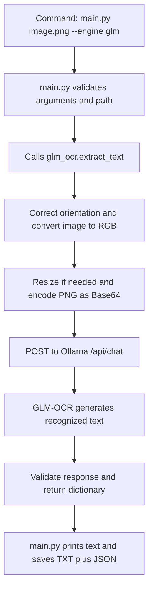

# GLM-OCR implementation — simple Hinglish explanation

Is project mein GLM-OCR ko ek alag Python module mein integrate kiya hai. Aap
`main.py` se engine select karte ho; `glm_ocr.py` image prepare karke Ollama ko
request bhejta hai. Ollama downloaded GLM-OCR model chalata hai aur extracted
text return karta hai.

Humne model ko train ya fine-tune nahi kiya. Existing pretrained model
`glm-ocr:q8_0` ko local Ollama runtime ke through use kiya hai.

## 1. Kaunsi file kya karti hai?

| File | Responsibility |
|---|---|
| `main.py` | Command read karna, engine select karna, extraction function call karna aur output save karna. |
| `glm_ocr.py` | Image validation, preprocessing, Ollama API request, response validation aur text return karna. |
| `test_glm_ocr.py` | GLM integration aur error handling ko mocked API responses se test karna. |
| `README_GLM.md` | Setup aur run commands. |

`glm_ocr.py` ek importable module hai. Current implementation ko run karne ka
entry point `main.py` hai.

## 2. Complete flow



Default API address `http://127.0.0.1:11434` hai. Yeh aapke computer ka local
Ollama server hai. Agar `--glm-host` se remote server select karoge, image us
server ko jayegi.

## 3. `main.py` se GLM function kaise call hota hai?

Command:

```powershell
python main.py image.png --engine glm
```

`argparse` se `image.png` aur `--engine glm` read hote hain. `--engine glm-ocr`
bhi accepted hai; internally usko `glm` mein normalize kiya jata hai.

GLM branch ka relevant code:

```python
from glm_ocr import extract_text as extract_glm_text

result = extract_glm_text(
    image_path,
    model=args.glm_model,
    host=args.glm_host,
    timeout=args.glm_timeout,
)
```

Import engine selection ke baad hota hai. GLM select karne par PaddleOCR ya
Tesseract ka extraction function call nahi hota.

## 4. `glm_ocr.py` ka function

```python
def extract_text(
    image_path: Path | str,
    *,
    model: str | None = None,
    host: str | None = None,
    timeout: float = 600,
) -> dict:
```

| Parameter | Meaning |
|---|---|
| `image_path` | Input image ka path. |
| `model` | Ollama mein installed model ka naam. |
| `host` | Ollama server ka address. |
| `timeout` | API response ke liye timeout, seconds mein. |

Default model `glm-ocr:q8_0` hai. Yeh model ka quantized variant hai. Default
timeout `600` seconds, yani 10 minutes hai.

Configuration ki priority:

1. Command-line argument / function parameter.
2. Environment variable: `GLM_OCR_MODEL` ya `OLLAMA_HOST`.
3. Code ke defaults: `glm-ocr:q8_0` aur `http://127.0.0.1:11434`.

## 5. Image preprocessing mein kya kiya?

Pehle path ko absolute path mein convert karke check kiya ki file exist karti hai.
Phir Pillow se image open hoti hai.

```python
image = ImageOps.exif_transpose(original).convert("RGB")
image.thumbnail((1600, 1600), Image.Resampling.LANCZOS)
```

Iska meaning:

- `exif_transpose`: camera image ke EXIF orientation ke according image rotate hoti hai.
- `convert("RGB")`: input ko common RGB color format mein convert karta hai.
- `thumbnail`: longest side maximum 1600 pixels tak rakhta hai aur aspect ratio preserve karta hai. Chhoti image ko upscale nahi karta.
- `LANCZOS`: resize karte waqt resampling method hai.

Image memory mein PNG banakar `BytesIO` buffer mein save hoti hai. Original
image file modify nahi hoti. Multi-frame images reject hoti hain, taaki sirf
first frame process karke baaki frames silently miss na ho jayein.

1600-pixel limit input size ko bound karti hai. Bahut chhota printed text resize
ke baad difficult ho sakta hai; aise case mein relevant document area crop karke
test karna useful hai. Current GLM route image inputs ke liye hai; PDF support
is route mein implement nahi kiya gaya hai.

## 6. Base64 kyon use kiya?

Ollama ke vision REST API mein image bytes ko Base64 string ke form mein bhejte
hain:

```python
base64.b64encode(buffer.getvalue()).decode("ascii")
```

Base64 image ko text mein transport karne ka format hai. OCR recognition model
request receive karne ke baad karta hai; Base64 conversion khud text extract
nahi karta.

## 7. Model ko kya request bheji?

Request ka simplified structure:

```json
{
  "model": "glm-ocr:q8_0",
  "messages": [
    {
      "role": "user",
      "content": "Text Recognition:",
      "images": ["<Base64 encoded PNG>"]
    }
  ],
  "stream": false,
  "options": {
    "temperature": 0,
    "num_ctx": 4096,
    "num_predict": 2048
  },
  "keep_alive": 0
}
```

| Setting | Code mein purpose |
|---|---|
| `Text Recognition:` | GLM-OCR ko text recognition task dene wala prompt. |
| `stream: false` | Complete response ek saath milta hai; terminal par live token streaming nahi hoti. |
| `temperature: 0` | Generation mein randomness reduce karne ke liye. Yeh OCR accuracy ki guarantee nahi hai. |
| `num_ctx: 4096` | Context window ko bound karta hai. Tokens characters ya words ke exactly equal nahi hote. |
| `num_predict: 2048` | Maximum generated output tokens ko bound karta hai. |
| `keep_alive: 0` | Request complete hone ke baad model unload karne ko kehta hai, taaki model memory release ho sake. Ollama server running reh sakta hai. |

Python standard library ke `Request` aur `urlopen` se JSON body ke saath
`POST {host}/api/chat` call hota hai. Alag Ollama Python SDK ki dependency add
nahi ki gayi hai. Image handling ke liye existing Pillow use hota hai.

`stream: false` ki wajah se `Running GLM-OCR through Ollama...` print hone ke
baad final response tak wait ho sakta hai. CPU inference aur first model load
mein time lag sakta hai.

## 8. Response se text kaise nikala?

Ollama response mein generated text yahan milta hai:

```python
message = result.get("message")
text = message.get("content") if isinstance(message, dict) else None
```

Return karne se pehle code verify karta hai:

- Response valid JSON object ho.
- Response mein inference error na ho.
- `message.content` non-empty string ho.
- `done` ki value `True` ho.

Function raw extracted text return karta hai. Usmein model ke generated
Markdown ya line breaks ho sakte hain.

## 9. Function kya return karta hai?

Example structure — values sirf explanation ke liye hain:

```json
{
  "engine": "glm",
  "model": "glm-ocr:q8_0",
  "image": "C:\\OCR-New\\demo.png",
  "text": "Demo Person\nDOB: 01/01/2000",
  "original_size": [1200, 800],
  "input_size": [1200, 800],
  "truncated": false,
  "usage": {
    "prompt_tokens": 300,
    "generated_tokens": 20,
    "total_duration_ns": 5000000000
  }
}
```

`original_size` EXIF orientation apply hone ke baad ki image dimensions hain.
`input_size` resize hone ke baad ki dimensions hain. `usage` values Ollama
response se aati hain; unavailable values `null` ho sakti hain.

`total_duration_ns` nanoseconds mein reported duration hai. Seconds mein dekhne
ke liye value ko `1_000_000_000` se divide kar sakte ho.

**Current GLM output raw OCR text + metadata hai.** Is branch par `parse_aadhaar()`
call nahi hota. Isliye GLM JSON mein automatically separate `name`,
`date_of_birth`, `address` waale Aadhaar fields nahi bante. Existing structured
Aadhaar extraction PaddleOCR branch mein hai.

## 10. Output files kaise save hoti hain?

`main.py` result receive karke engine ke naam ka folder banata hai:

```python
output_dir = args.output / "glm"
text_path.write_text(result["text"], encoding="utf-8")
json_path.write_text(
    json.dumps(result, ensure_ascii=False, indent=2),
    encoding="utf-8",
)
```

`image.png` ke liye files:

```text
output/
└── glm/
    ├── image.txt
    └── image.json
```

UTF-8 aur `ensure_ascii=False` Hindi text ko readable form mein save karte hain.
Same image stem par dobara run karne se uski output files overwrite hoti hain.

## 11. Error handling

| Situation | Code ka behavior |
|---|---|
| File missing | File/path error show hota hai. |
| Timeout zero ya negative | Input validation error milta hai. |
| Invalid server URL | Request bhejne se pehle reject hota hai. |
| Ollama unreachable | Ollama start karne aur `ollama serve` ki instruction milti hai. |
| HTTP 404 | Model pull command aur host check ki instruction milti hai. |
| Other HTTP failure | Server logs aur memory check karne ka message aata hai. |
| Request timeout | Crop ya `--glm-timeout` increase karne ka message milta hai. |
| Invalid JSON / empty text / incomplete response | Extraction failure report hoti hai. |
| Output token limit reached | `truncated: true` milta hai; partial files save hoti hain aur incomplete-output message print hota hai. |

Normal successful CLI run ka exit code `0` hai. Extraction failure ya truncated
GLM result par `main.py` exit code `1` deta hai. Invalid CLI arguments ya missing
input path par argument parser exit code `2` deta hai.

## 12. Run commands

Model pehli baar download karne ke liye:

```powershell
ollama pull glm-ocr:q8_0
```

Ollama app running honi chahiye. Agar manually server start karna ho, alag
PowerShell terminal mein run karo:

```powershell
ollama serve
```

Image extract karne ke liye:

```powershell
cd C:\OCR-New
python main.py image.png --engine glm
```

Custom timeout aur output folder:

```powershell
python main.py image.png --engine glm --glm-timeout 900 --output results
```

Is command ki files `results\glm\image.txt` aur `results\glm\image.json` mein
save hongi.

Result read karne ke liye:

```powershell
Get-Content output\glm\image.txt -Encoding utf8
Get-Content output\glm\image.json -Encoding utf8
```

## 13. Testing mein kya verify kiya?

`test_glm_ocr.py` mein mocked Ollama responses use karke Unicode text,
image request, model missing, server unavailable, empty/incomplete response,
generation limit, large-image resizing aur `main.py` output routing check kiye.
Mocks se integration behavior verify hota hai; real model ki OCR accuracy nahi.

```powershell
python -m unittest test_glm_ocr -v
```

`apeksh.webp` par real GLM-OCR run bhi successful hua tha aur TXT/JSON save hui
thi. English name, DOB aur address recognize hue. Kuch Hindi words galat read
hue the, isliye successful exit code ko perfect transcription nahi samajhna
chahiye. Is implementation mein per-line OCR confidence calculate nahi kiya hai.

## References

- Project code: [glm_ocr.py](glm_ocr.py), [main.py](main.py), [test_glm_ocr.py](test_glm_ocr.py).
- Model project: [GLM-OCR](https://github.com/zai-org/GLM-OCR).
- Runtime API: [Ollama chat](https://docs.ollama.com/api/chat) and [vision inputs](https://docs.ollama.com/capabilities/vision).
